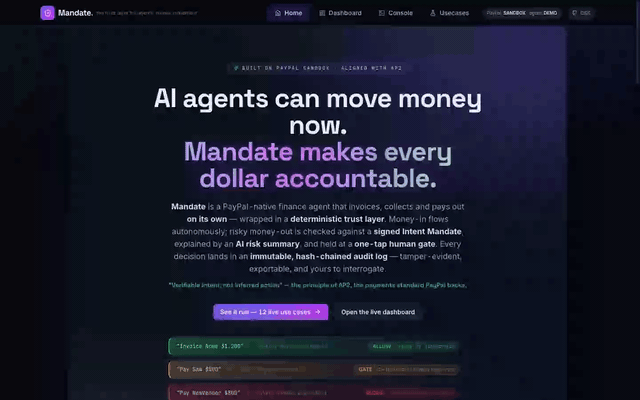
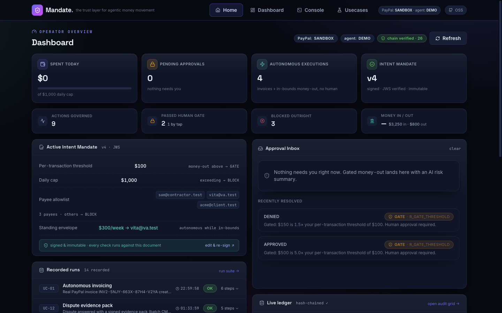
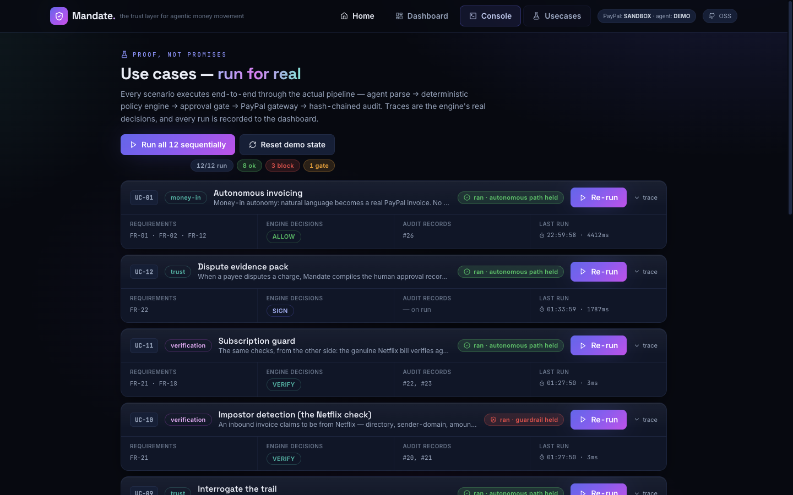
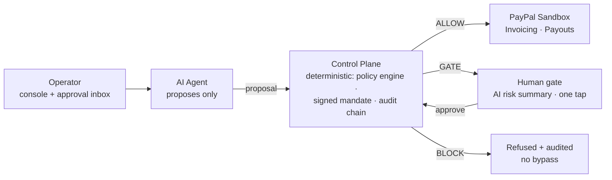

# Mandate — the trust layer for agentic money movement

<p align="center">
  
</p>

<p align="center">
  <a href="docs/screenshots/home.png"></a>
  <a href="docs/screenshots/dashboard.png"></a>
  <a href="docs/screenshots/usecases.png"></a>
</p>
<p align="center">
  <i>Home (live policy verdict strip) · Dashboard (KPIs + signed mandate + recorded runs) · Usecases (12 real run cards)</i>
</p>

**Mandate** is a PayPal-native autonomous finance agent that *invoices, collects, and pays out on its own* — wrapped in a deterministic approval gate that makes **every dollar it moves accountable**. Low-risk money-in flows autonomously; risky money-out is checked against a signed policy (an **Intent Mandate**), explained by an AI risk summary, and held for one-tap human approval. Everything lands in a SHA-256 **hash-chained audit log** — and inbound invoices claiming to be from "Netflix" get stamped **VERIFIED** or **IMPOSTOR** by a known-merchant directory check.

> Built for the [PayPal AI Hackathon](https://paypalaihackathon.devpost.com/) · aligned with **AP2** (Google's Agent Payments Protocol, backed by PayPal): *"verifiable intent, not inferred action — an agent's reasoning is never the authorization; a signed mandate is."*

## For judges — run it in 60 seconds

Zero keys needed. The bundled mock gateway implements PayPal's exact semantics (stateful invoices, idempotent payouts, webhook events), so the entire trust layer runs offline:

```bash
git clone https://github.com/0xv3nm09/mandate && cd mandate/server
npm install && npm run dev        # Node ≥ 24 → http://localhost:8787
```

Then open **Usecases → "Run all 12 sequentially"** — every trace is a real control-plane decision. To exercise the **live PayPal sandbox REST** instead, create free credentials at [developer.paypal.com](https://developer.paypal.com), copy `.env.example` → `.env`, set `PAYPAL_CLIENT_ID` / `PAYPAL_CLIENT_SECRET` (plus `PAYPAL_SANDBOX_RECIPIENT` = your sandbox personal account email so invoices/payouts route to a real test account), restart — the health pill flips to `SANDBOX` and all money movement hits `api-m.sandbox.paypal.com`.

**Built during the Submission Period:** the entire project was created between Oct 28 and Nov 5, 2026 (see commit history) — first commit is the scaffold, latest commits are live-sandbox evidence.

## The 30-second architecture



**The trust boundary sits between the control plane and PayPal**: money leaves the account only after a policy pass (plus a human approval when gated). The agent holds no PayPal credentials for money movement. **Code owns the facts; the model only writes language** — no LLM call sits anywhere on the decision path, so a hallucination can't move money.

**Full technical diagram set** — [docs/diagrams.md](docs/diagrams.md): system zones · policy decision flowchart · gated-payout and standing-payout sequences · inbound-verification flow · dispute evidence pack sequence · action lifecycle state machine · invoice lifecycle · audit hash-chain construction · data model (ER) · deployment architecture · evidence workflow.

## The 30-second demo

## Quick start (zero external keys needed)

```bash
# 1. server (Node ≥ 24 — uses the built-in node:sqlite)
cd server
npm install
npm run dev          # → http://localhost:8787 (serves the web app too)

# 2. web (only if you want to develop the UI with HMR)
cd ../web
npm install
npm run dev          # → http://localhost:5173 (proxies /api to :8787)
```

That's it — with no env vars the app runs in **full demo mode**: a stateful `MockPayPal` gateway (identical semantics to the real REST client, including webhook events) and a deterministic NL parser drive the exact same control plane as live mode.

Then open **http://localhost:8787** and either:
- hit **Usecases → “Run all 9 sequentially”** — every scenario executes end-to-end through the real engine and renders the actual trace, or
- chat with the agent in the **Console** (suggestion chips included).

### Live PayPal sandbox (optional)

1. Create sandbox business + personal accounts at [developer.paypal.com](https://developer.paypal.com/).
2. Copy `server/.env.example` → `server/.env`, fill `PAYPAL_CLIENT_ID` / `PAYPAL_CLIENT_SECRET` (+ `PAYPAL_WEBHOOK_ID` after adding a webhook pointing at `POST /api/paypal/webhook`).
3. Restart the server — the health pill switches to `SANDBOX` and all money movement goes through `api-m.sandbox.paypal.com`.

### LLM mode (optional)

Set `ANTHROPIC_API_KEY` (or `OPENAI_API_KEY`) to upgrade the agent from the deterministic parser to a Vercel AI SDK tool loop. Either way the agent can only **propose** — the control plane decides.

## Try these in the Console

| Say | What happens |
|---|---|
| “Invoice Acme $1,200 for October design” | Invoice created + sent autonomously (money-in) |
| “Chase Acme” | AI-drafted reminder, tone escalates per attempt |
| “simulate paid from Acme” | Fires the real `INVOICING.INVOICE.PAID` webhook path |
| “Pay contractor Sam $500” | **GATE** → AI risk summary → approve in the inbox → payout executed |
| “Pay NewVendor $800” | **BLOCKED** — payee not on the signed allowlist; no approval exists |
| “Cap daily at $500” / “Pay Vita $300 weekly” | Agent drafts the mandate diff → **you sign** a new version (UC-07) |
| “Run standing” | Pre-authorized weekly payout runs with **no human in the loop**; drift → gate (UC-08) |
| “Why was anything blocked?” | Interrogate the hash-chained trail + counterfactual + signed receipt (UC-09) |

## Trust-layer guarantees (the scored part)

- **Deterministic policy engine** (`server/src/control-plane/policy.ts`) — pure function; ALLOW / GATE / BLOCK with reason codes; hard blocks (unknown payee, currency, daily cap) are un-bypassable by approval.
- **Signed Intent Mandate** (`mandate.ts`) — your policy is a JWS (via `jose`); every edit creates a new signed version; every decision records the version it used.
- **Hash-chained audit** (`audit.ts`) — each record commits to the previous hash; `GET /api/audit/verify` recomputes the whole chain; receipts are exportable + independently verifiable.
- **Idempotent money-out** — every payout carries a unique idempotency key (approval id / standing-week); resubmission can never double-pay.
- **Failure-safe** — PayPal 5xx/timeouts retry with backoff then queue; actions stay PENDING, never silently execute; webhook events are deduped.
- **Kill switch** — global stop halts proposals, freezes approvals, refuses execution (FR-15).

## Stack

React 18 · Vite · TypeScript · Tailwind · AG Grid (community) · Hono · Vercel AI SDK (optional) · `jose` · `node:sqlite` · PayPal REST (Invoicing, Payouts, Webhooks) · SSE.

**AG Grid (sponsor tool) usage:** the hash-chained audit ledger is rendered in AG Grid Community — column sorting/resizing, pagination, pinned receipt-export column, live refresh on SSE events. It is the primary inspection surface for every decision the engine makes (Console → Audit Grid), plus the Invoices table. See `evidence/audit-chain.json` for the data it renders.

## Repo layout

```
server/src/
  control-plane/   policy.ts (pure engine) · mandate.ts (JWS) · audit.ts (hash chain) · approvals.ts (queue+SSE)
  paypal/          gateway.ts (SANDBOX + MOCK behind one interface)
  agent/           parser.ts (deterministic NL) · textgen.ts (language-only LLM) · agent.ts (facade)
  usecases/        runner.ts (UC-01…UC-09 end-to-end with traces)
  routes/api.ts    all HTTP routes
web/src/components/  Home · Console · AgentConsole · ApprovalInbox · AuditGrid · MandateEditor · Usecases
```

## Deploy

### Render (full app: API + console, recommended for judges)

`render.yaml` is included — push the repo → Render → New → Blueprint. The web service builds the console, serves it and the API from one origin.

### GitHub Pages (static console, like a demo site)

The build is portable (`base: './'`, hash routing — no server rewrites needed):

```bash
cd web
VITE_API_BASE=https://your-mandate.onrender.com npm run build   # point the static site at the backend
```

Then publish the repo to GitHub and enable **Pages → Deploy from branch → root**. The root `index.html` stub redirects visitors into `web/dist/index.html` carrying the hash (e.g. `…/mandate/#usecases`). On the backend, set `ALLOWED_ORIGINS=https://<user>.github.io` so the Pages origin may call the API (admin token still guards mutations).

## Notes

- Demo money only — sandbox/mock; no real funds move. Mandate is an independent hackathon project, not affiliated with or endorsed by PayPal.

## Hackathon rules compliance (judge checklist)

- **Meaningful PayPal use** — three layers: (1) the official [`@paypal/agent-toolkit`](https://developer.paypal.com/ai-tools/toolkit) attached read-only (list/get invoices + disputes — `GET /api/paypal/toolkit` shows status); (2) documented PayPal REST used directly for everything money-moving — Invoicing v2 (create/send/remind), Payouts v1 with `sender_batch_id` idempotency, `verify-webhook-signature`, `simulate-event` — all sandbox-first per PayPal's quickstart; (3) PayPal's own best practices implemented: env-var secrets, system-prompt agent control, human oversight where judgment matters, error handling.
- **Meaningful AI use** — Vercel AI SDK v5 tool loop (a PayPal-supported framework) with governed tools (`propose_payout` has no `execute`, by design), LLM-written risk explanations / reminders / mandate drafts, NL audit interrogation (UC-09), and a deterministic fallback agent so the trust layer never depends on a model.
- **Functional demo** — hosted URL (Render blueprint included) or copy-paste repo run steps: `cd server && npm i && npm run dev`.
- **Open source + license** — MIT at repo root; make it visible in the GitHub About/sidebar.
- **Video (<3 min, YouTube)** — script in the build workbook §14; no third-party trademarks presented as ours (see footer disclaimer).

MIT licensed.
