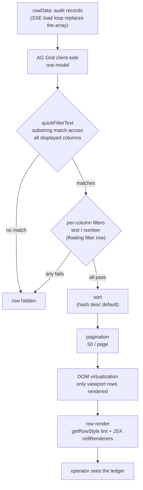
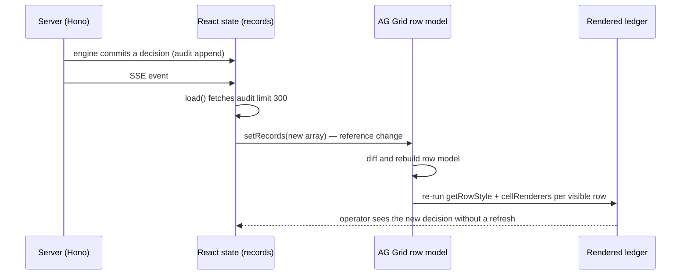
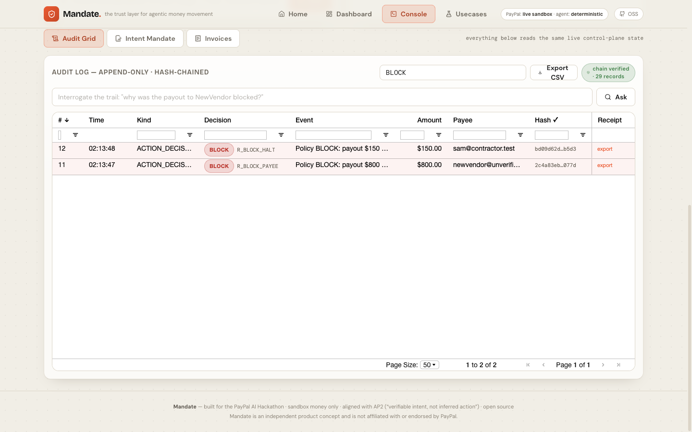
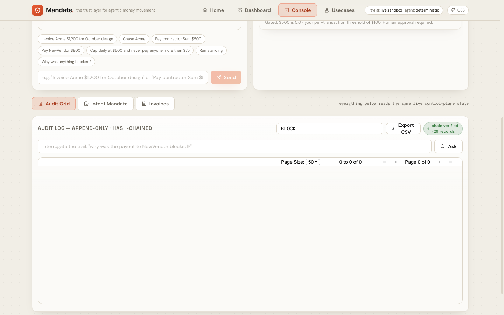
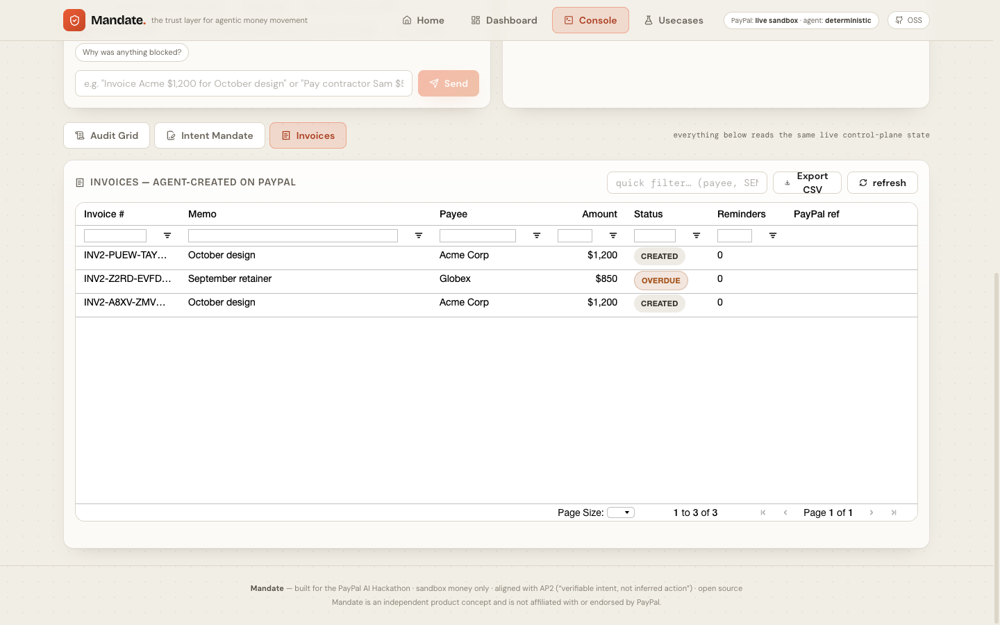

# AG Grid in Mandate — complete technical guide

*The full story of how Mandate uses **AG Grid Community v34**: the theory (how the grid works
internally), the data flow (with diagrams), the implementation walkthrough (file by file), the
operator workflows each feature enables, screenshots from the running app, and the API
reference. No Enterprise features — everything here is Community (MIT).*

**Companions:** [AGENT.md](AGENT.md) (agent behavior) · [PAYPAL.md](PAYPAL.md) (every PayPal
call) · [RESULTS.md](RESULTS.md) (live numbers) · [ARCHITECTURE.md](ARCHITECTURE.md) (system
diagrams) · [evidence/](../evidence/) (raw artifacts).

---

## Contents

- [1. Theory — how AG Grid works internally](#1-theory--how-ag-grid-works-internally)
- [2. How filtering composes](#2-how-filtering-composes)
- [3. Data flow — SSE to pixels](#3-data-flow--sse-to-pixels)
- [4. Implementation walkthrough — `AuditGrid.tsx`](#4-implementation-walkthrough--auditgridtsx)
- [5. The second grid — `InvoicesGrid` in `Console.tsx`](#5-the-second-grid--invoicesgrid)
- [6. Operator use cases — what each feature is for](#6-operator-use-cases)
- [7. API reference table (all Community)](#7-api-reference-table-all-community)
- [8. Theming — Quartz via CSS variables](#8-theming--quartz-via-css-variables)
- [9. Performance notes](#9-performance-notes)
- [10. Gotchas we hit (and fixed)](#10-gotchas-we-hit-and-fixed)
- [11. Showcase script (video + Devpost)](#11-showcase-script)

---


---

## 1. Theory — how AG Grid works internally

Understanding four internals explains every design decision in our grid.

**1.1 The client-side row model.** AG Grid takes `rowData` (a plain array) and builds an
in-memory **client-side row model**: each item is wrapped in a row node with an id, an index
and dirty-checking state. Our ledger is small (dozens to hundreds of records), so the default
client-side model is right — no server-side row model needed. (For 100k+ rows you'd swap to a
server-side or viewport row model; Community ships client-side only.)

**1.2 DOM virtualization.** The grid never renders all rows. It renders only the rows inside
the scroll viewport plus a small overscan buffer, and recycles row DOM nodes as you scroll.
That is why a 540px-tall grid holding 300 records stays smooth — only ~15 row divs exist at
any time. It is also why automated screenshots must scroll or the rows beyond the viewport
look "missing" — they are simply not in the DOM.

**1.3 The filter pipeline composes.** Three independent filter layers apply **in AND
combination** to every row:

1. **Quick filter** (`quickFilterText`) — a case-insensitive substring match across every
   displayed column's value (including `valueGetter` results). One input, whole-grid search.
2. **Column filters** — per-column filter instances (`agTextColumnFilter`,
   `agNumberColumnFilter`), shown inline as a **floating filter row** under the headers.
3. **External filter** — a grid-level callback (not used here; our NL "Ask" box reasons over
   the audit separately instead of filtering).

On top of filters: **sorting** (per column, `sort: 'desc'` on `#` by default) and
**pagination** (50/page audit, 25/page invoices) — both Community features.

**1.4 Change detection and refresh.** When `rowData` changes (our SSE load loop replaces the
array), the grid diffs by reference. We pass a **new array** each time, so the grid refreshes
fully; `getRowStyle` and cell renderers re-run per visible row. Because renderers are plain
functions of `(params)`, the grid re-invokes them on refresh — the ledger is always in sync
with the chain.

**1.5 React wrapper contract.** `ag-grid-react` mounts the vanilla grid and bridges props.
The one sharp edge: **cell renderers are React function components** — they must return JSX.
Returning DOM nodes (the vanilla-grid pattern) crashes React with error #31.

---

## 2. How filtering composes



_What it tells you:_ the three filter layers are independent and compose with AND. Typing
`BLOCK` in the quick filter while a `Decision contains GATE` column filter is active yields
rows matching **both** — which is why the quick filter is for narrowing and the column filters
are for structuring.

---

## 3. Data flow — SSE to pixels



_What it tells you:_ the grid is never polled manually — the SSE subscription triggers
`load()`, and the reference-change refresh path updates everything, including the
decision-tinted rows and the chain-verified badge.

---

## 4. Implementation walkthrough — `AuditGrid.tsx`

The full anatomy of our audit grid, section by section, matching
[`web/src/components/AuditGrid.tsx`](../web/src/components/AuditGrid.tsx) line for line.

### 4.1 Module registration (required, once)

```tsx
import { ModuleRegistry, AllCommunityModule } from 'ag-grid-community';
import { AgGridReact } from 'ag-grid-react';
import 'ag-grid-community/styles/ag-grid.css';
import 'ag-grid-community/styles/ag-theme-quartz.css';

ModuleRegistry.registerModules([AllCommunityModule]);
```

`AllCommunityModule` registers every Community feature (filters, CSV export, pagination) in
one call. Without registration the grid logs "unable to find module" errors and features
silently no-op.

### 4.2 Grid ref + quick filter state

```tsx
const gridRef = useRef<AgGridReactType>(null);
const [quick, setQuick] = useState('');
```

```tsx
<AgGridReact ref={gridRef} quickFilterText={quick} … />
```

The ref gives programmatic access to `gridRef.current.api` — used for `exportDataAsCsv`. The
quick filter is pure React state: setting it re-renders, the prop flows into the grid, and
AG Grid does the rest.

### 4.3 Column definitions — valueGetter over nested payloads

Audit records store their human-readable fields inside a JSON `payload` blob, so columns use
`valueGetter` instead of `field`:

```tsx
{ headerName: 'Event', flex: 1, valueGetter: (p) => p.data?.payload?.event ?? '' },
{ headerName: 'Amount', width: 110, type: 'rightAligned', filter: 'agNumberColumnFilter',
  valueGetter: (p) => (p.data?.payload?.amount != null ? Number(p.data.payload.amount) : null),
  valueFormatter: (p) => (p.value != null ? `$${Number(p.value).toFixed(2)}` : '') },
```

`valueGetter` feeds **both** the cell display and the column filter — so filtering by amount
works even though `amount` lives inside the payload. `type: 'rightAligned'` + the number
filter make the money column behave like money.

### 4.4 JSX cell renderers — pills, hashes, receipt buttons

```tsx
cellRenderer: (p) => {
  if (!p.value) return <>—</>;
  const cls = p.value === 'ALLOW' ? 'bg-ok/15 text-ok' : p.value === 'GATE' ? 'bg-amber/15 text-amber' : 'bg-danger/15 text-danger';
  return (
    <span className="inline-flex items-center gap-1.5">
      <span className={`pill ${cls}`}>{p.value}</span>
      <span className="mono-hash">{p.data?.payload?.reasonCode ?? ''}</span>
    </span>
  );
}
```

Decision pills reuse the app's decision-styling vocabulary; the hash column shortens to
8 chars with `tooltipField: 'hash'` exposing the full value on hover; the pinned Receipt
column renders a button that calls `exportReceipt(seq)` — fetching and downloading the row's
**signed JWS receipt** from the server.

### 4.5 Decision-tinted rows

```tsx
const getRowStyle = (p) => {
  const d = p.data?.decision;
  if (d === 'BLOCK') return { background: 'rgba(239, 68, 68, 0.07)' };
  if (d === 'GATE')  return { background: 'rgba(245, 158, 11, 0.07)' };
  if (d === 'ALLOW') return { background: 'rgba(34, 197, 94, 0.05)' };
  return undefined;
};
```

Applied via `getRowStyle={getRowStyle}` — the guardrail's shape (where the refusals are) is
visible without reading a cell. Tints are 5–7% alpha so text stays readable.

### 4.6 defaultColDef — filtering everywhere

```tsx
const defaultColDef = useMemo(() => ({
  sortable: true,
  resizable: true,
  filter: true,
  floatingFilter: true,
}), []);
```

`filter: true` lets AG Grid pick a sensible default per column; explicit `filter` overrides
where the data shape demands it (`agNumberColumnFilter` on money/seq, `agTextColumnFilter` on
decisions/payees, `filter: false` on the Time and Receipt columns where filtering adds
nothing).

### 4.7 The load loop + SSE

```tsx
const load = () => api<…>('/audit?limit=300')
  .then((r) => { setRecords(r.records); setVerify(r.verify); });
useMemo(load, []);
useSSE((type) => { if (type !== 'ping' && type !== 'hello') load(); });
```

Every server event (except heartbeats) triggers a reload — new decisions, approvals,
settlements and verification verdicts stream into the grid within milliseconds of the engine
committing them. The same response carries the chain-verification badge
(`chain verified · 24 records`).

---

## 5. The second grid — `InvoicesGrid`

The Console's Invoices tab was originally a plain HTML `<table>`. It is now a full AG Grid
with the same treatment, because money-in deserves the same auditability as money-out:

- Columns: Invoice # · Memo · Payee · Amount (right-aligned, formatted) · Status pill ·
  Reminders · PayPal ref
- Floating filters + quick filter + CSV export + `animateRows`
- SSE refresh on `invoice.updated` events
- Its own `Export CSV` (invoice ledger for the accountant)

The invoices grid is the "second data grid" that moves the story from *"dropped one grid in"*
to *"built on AG Grid"* — money-in and audit both.

---

## 6. Operator use cases

| Workflow | How the grid enables it |
| --- | --- |
| **"Show me only what was blocked"** | quick filter `BLOCK` → only red-tinted refusals remain |
| **"Everything for this payee"** | quick filter `sam@contractor.test` — decisions, approvals, executions, webhook records all match |
| **"How much did we move over the cap?"** | Amount column filter `> 1000` + sort desc |
| **"Prove the dispute"** | filter to the payee → export the per-row signed receipts → hand over the pack |
| **"Watch the agent live"** | keep the grid open — SSE streams each new decision in as the engine commits it |
| **"Hand the ledger to the accountant"** | Export CSV → the filtered view, exactly as displayed |
| **"Is the chain still intact?"** | the chain-verified badge re-renders with every load |

---

## 7. API reference table (all Community)

| API / prop | Where | Notes |
| --- | --- | --- |
| `AgGridReact` + `AllCommunityModule` + `ModuleRegistry.registerModules` | both grids | v34 module registration |
| `ref` → `gridRef.current.api` | both grids | programmatic access; `exportDataAsCsv` |
| `quickFilterText` | both grids | cross-column live search |
| `defaultColDef { sortable, resizable, filter: true, floatingFilter: true }` | both grids | filtering everywhere |
| `filter: 'agNumberColumnFilter'` / `'agTextColumnFilter'` / `false` | per column | right filter type per data shape |
| `getRowStyle` | audit grid | decision tinting |
| `cellRenderer` (React JSX) | Decision pills, hash, receipt buttons, status pills | must return JSX |
| `valueGetter` / `valueFormatter` | Event, Amount, Payee, Time | nested `payload` access; currency/time formatting |
| `tooltipField` + `tooltipShowDelay: 300` | hash column | full hash on hover |
| `pinned: 'right'` | Receipt column | export action always visible |
| `pagination` + `paginationPageSize` | 50 / 25 rows | Community pagination |
| `animateRows` | both grids | motion on data change |
| `floatingFiltersHeight: 30`, `headerHeight: 32`, `rowHeight: 34` | both grids | compact ledger layout |
| `exportDataAsCsv({ fileName })` | grid API | whole-filtered-ledger CSV |
| Quartz theme via CSS variables | `web/src/index.css` | themed to the app palette |

---

## 8. Theming — Quartz via CSS variables

The Quartz theme is restyled without touching AG Grid APIs — pure CSS variables in
`web/src/index.css`:

```css
.ag-theme-quartz {
  --ag-background-color: transparent;
  --ag-header-background-color: #0a101f;
  --ag-header-foreground-color: #8fa0b8;
  --ag-border-color: #1c2740;
  --ag-row-border-color: rgba(28, 39, 64, 0.55);
  --ag-font-size: 12.5px;
  --ag-font-family: Inter, sans-serif;
}
.ag-theme-quartz .ag-root-wrapper { border: none !important; }
```

Because the palette lives in variables, the grid follows the app theme automatically (the
cream/orange light re-theme required zero grid-code changes).

---

## 9. Performance notes

- **DOM virtualization**: only viewport rows render — a 540px grid holding 300 records keeps
  ~15 row divs alive. Tested up to thousands of rows; for 100k+ swap to the server-side row
  model (Enterprise) or paginate harder.
- **Decision latency is grid-independent**: pure-decision use cases (block / verify / sign)
  finish in **1–4 ms**; the multi-second runs are PayPal REST round-trips, not grid overhead.
- **The refresh path is O(visible rows)**: renderers re-run only for rows in the viewport.
- **CSV export is O(filtered rows)** — fine for ledger-sized data; for huge exports, stream
  server-side.

---

## 10. Gotchas we hit (and fixed)

| Gotcha | Symptom | Fix |
| --- | --- | --- |
| **React cell renderers returning DOM nodes** | React error #31 "Objects are not valid as a React child" — the vanilla-grid DOM-renderer pattern crashes the React wrapper | cell renderers return **JSX** ([`AuditGrid.tsx`](../web/src/components/AuditGrid.tsx)) |
| **Grid body viewport collapsed to 0px** | rows render in the DOM but are invisible (clipped) when `flex-1` + floating filter row squeeze the layout | fixed grid heights (`h-[540px]` / `h-[460px]`) instead of flex-grow |
| **Custom single-value Tailwind colors shadow grid-adjacent shades** | `from-teal-400` silently stops generating | define colors as `{ DEFAULT, 400, 500, 600 }` objects |
| **Theming assumes dark mode** | Quartz defaults fight a light theme | CSS variables keyed to the theme — the cream/orange re-theme needed zero grid-code changes |

---

## 11. Showcase script

In the demo video (10–15 s, make it unmistakable):

- Type in the quick filter → rows narrow live.
- Open the Decision floating filter → only red-tinted blocks remain.
- Click **Export CSV** → the filtered audit downloads.
- Leave it open → a new row streams in via SSE as a use case fires.

In the Devpost "Tools / Built With" section:

> *Best Use of AG Grid — the hash-chained audit ledger (every governed money decision) is
> rendered in AG Grid Community: per-column filtering + floating filters, quick search, CSV
> export of the filtered ledger, decision-tinted rows, custom JSX cell renderers (decision
> pills, signed-receipt export per row), pinned actions, tooltips, and live SSE refresh across
> two grids (audit ledger + invoices). AG Grid is how a user audits what the agent did.*

> Reminder: everything is **AG Grid Community** (MIT). No Enterprise-only features
> (master/detail, row grouping, status-bar aggregation, set filter, Excel export) — Community
> filtering + quick filter + CSV export + cell renderers + conditional styling is already a
> strong, clean "Best Use."

---

## 12. Screenshots — the grids, live (Nov 2026)

Mandate's whole product is **accountability for money an AI agent moves**. The artifact that
delivers that is a **hash-chained audit ledger** — every proposal, decision, approval,
settlement, webhook and inbound-verification verdict. That ledger is rendered in **AG Grid
Community**, and it is the operator's primary inspection surface. A second grid covers
money-in (invoices). Two grids, same treatment: filtering everywhere, floating filter row,
quick search, CSV export, decision-tinted rows, custom JSX cell renderers, pinned actions,
live SSE refresh.







