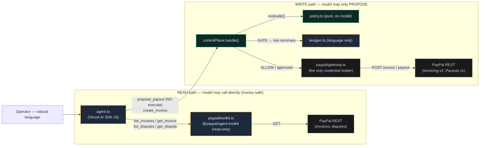

# The AI — architecture, module map, and benchmarks

*How AI is used in Mandate, exactly which modules carry it, how it connects to PayPal, and what it measures to.*
*Companion to [AGENT.md](AGENT.md) (agent behavior), [ARCHITECTURE.md](ARCHITECTURE.md) (diagrams), [PAYPAL.md](PAYPAL.md) (every PayPal call).*

---

## 0. One-line thesis

**The model writes language; deterministic code owns every money decision.** The AI agent can *propose* and *describe* — it can never *authorize* or *execute* a transfer. That single rule is what makes an autonomous PayPal agent safe, and it is enforced structurally (a tool with no `execute`), not by a prompt.

---

## 1. Where AI is used (and where it is forbidden)

| The AI **does** (language + proposing) | The AI **never** does (decisions + money) |
|---|---|
| Parse natural language into a proposed action | Decide ALLOW / GATE / BLOCK — that is `policy.ts`, a pure function |
| Draft invoice + tone-escalating reminder copy | Hold PayPal credentials for money-out |
| Write the plain-language risk summary on a gated approval | Call PayPal Payouts / Invoicing-send directly |
| Draft a natural-language mandate-diff (human then signs) | Compute running totals / daily spend (owned by the audit chain) |
| Answer "why was this blocked?" over the audit trail | Move a dollar without a policy pass (and, if gated, a human tap) |
| Read-only: list/get invoices & disputes via the official toolkit | Alter a signed mandate without a human signature |

---

## 2. The AI stack (tools & models)

| Layer | Package / service | Role |
|---|---|---|
| Agent loop | **Vercel AI SDK v5** (`ai`) | Tool-calling loop; turns NL into governed tool calls |
| Model (keyed) | **Anthropic Claude** (`@ai-sdk/anthropic`, e.g. `claude-sonnet-4-5`) **or OpenAI GPT-4o** (`@ai-sdk/openai`) | The LLM behind the agent — **language only** |
| Model (zero-key) | **Deterministic parser** (`parser.ts`) | Regex/intent fallback so the demo runs with no key; same contract as the LLM |
| PayPal AI | **Official `@paypal/agent-toolkit`** | Read-only eyes: `list_invoices`, `get_invoice`, `list_disputes`, `get_dispute` |
| Schemas | **`zod`** | Tool input schemas the SDK validates |

---

## 3. Module map — every AI-touching file and what it connects to

> This is the "very detailed connection" view: each module, what it does, what it imports (calls), and what calls it.

| Module | AI role | Imports / calls | Called by | Connects to PayPal? |
|---|---|---|---|---|
| **`server/src/agent/agent.ts`** | **The agent facade.** `chat()` → `llmChat()` (LLM mode) or `parserChat()` (deterministic). Defines the three governed tools; routes every proposal into the control plane. | `parser.parse`, `textgen.*`, `controlPlane.handle`, `mandate.signMandate`, `approvals.setHalted`, `services.*`, `paypal/toolkit.readOnlyToolkitTools` | `routes/api.ts` `POST /api/chat`; `usecases/runner.ts` | **Indirectly only** — it calls `controlPlane.handle()`, never the gateway. Read path: attaches the toolkit's read-only tools. |
| **`server/src/agent/parser.ts`** | Deterministic NL → `ParsedIntent` (11 intents). No model. The zero-key brain and the LLM-failure fallback. | — (pure) | `agent.parserChat` | No |
| **`server/src/agent/textgen.ts`** | **Language only.** `riskExplanation`, `reminderDraft`, `mandateDraft`, `auditAnswer`. Dynamically imports the LLM provider; every function has a deterministic fallback. | `ai`, `@ai-sdk/*` (dynamic) | `controlPlane.handle` (risk summary), `services.sendReminder`, `agent` (mandate/audit) | No (writes text that is attached to records) |
| **`server/src/paypal/toolkit.ts`** | Loads the **official `@paypal/agent-toolkit`** read-only tools, guarded; status at `GET /api/paypal/toolkit`. | `@paypal/agent-toolkit/ai-sdk` (dynamic) | `agent.llmChat`, `routes/api.ts` | **Yes, read-only** — list/get invoices & disputes (money-safe, so the model may call them) |
| **`server/src/controlPlane.ts`** | **The boundary.** `handle()` is the only path from a proposal to money. Calls the policy engine, enqueues approvals, executes via the gateway, writes audit. **No model on this path.** | `policy.evaluate`, `mandate.ensureMandate`, `audit.*`, `approvals.*`, `gateway.*`, `textgen.riskExplanation` (language only) | `agent.*`, `services.*`, `routes/api.ts` | **Yes** — the *only* module that calls the gateway for money-out |
| **`server/src/control-plane/policy.ts`** | **The decision.** Pure `evaluate()` → ALLOW/GATE/BLOCK with 8 reason codes. Zero I/O, zero model, zero randomness. | — (pure) | `controlPlane.handle` | No |
| **`server/src/paypal/gateway.ts`** | **The only credential holder.** Sandbox REST (OAuth, Invoicing, Payouts, webhooks) + mock twin. | PayPal REST | `controlPlane.*`, `services.*` | **Yes** — owns all PayPal creds; unreachable by the agent |

**The rule the table encodes:** the agent (`agent.ts` + `textgen.ts` + `toolkit.ts`) can reach PayPal **only** for read-only data, and can reach money **only** by handing a proposal to `controlPlane.ts`, which alone calls `gateway.ts`. The model is two modules away from a credential.

---

## 4. How the AI connects to PayPal — the two paths



**Read path:** the model can look at PayPal data directly through the official toolkit — low risk, no money. **Write path:** the model's `propose_payout` tool has **no `execute`**, so its call is captured as a *proposal* and routed through `controlPlane → policy → gateway`. The model never holds a credential and never makes the decision.

### Worked example — the gated $500 payout (UC-03)
```
"Pay contractor Sam $500"
  → agent.ts            model emits propose_payout{receiver, 500}  (NO execute → proposal)
  → controlPlane.handle  saves action, calls…
  → policy.evaluate      $500 > $100 perTxn  →  GATE · R_GATE_THRESHOLD   (deterministic, ~ms)
  → textgen.riskExplanation   model writes the plain-English "why"  (language only)
  → approvals.enqueue    approval card to the inbox (SSE), 10-min TTL
  → [human taps Approve]
  → controlPlane.executePayout   idempotency key approval:…
  → gateway.createPayout   POST /v1/payments/payouts  →  real batch ZCWVF6MKS57FG
  → audit.appendAudit    hash-chained record at every step
```
The model appears exactly twice — proposing, and explaining. The decision and the money are both outside it.

---

## 5. Benchmarks

Measured from the committed evidence bundle (`evidence/stats.json`, `evidence/runs-summary.json`) — a real live-sandbox sweep. "Benchmark" here means the properties that actually matter for an agent that moves money: **safety, latency, coverage, determinism** — not model accuracy, because the model makes no decisions to score.

### 5.1 Safety benchmark (the headline)
From `evidence/stats.json` (one recorded sweep):

| Metric | Value |
|---|---|
| Actions governed (hit the policy engine) | **8 / 8 = 100%** |
| Executed autonomously (ALLOW) | 3 |
| Executed after human approval | 1 |
| Gated for a human | 2 |
| Blocked outright (no approval path) | 2 |
| Money-out moved | $500 — **every dollar via an ALLOW or a human approval** |
| **Money moved without a policy pass** | **0** |
| Audit records / chain verify | 24 / `verify.ok = true` |

**The property:** across every run, **no money moved that did not first pass `policy.evaluate()`** (and, when gated, a human tap). This is the number an "AI that moves money" should be judged on, and it is enforced by construction.

### 5.2 Latency benchmark
From `evidence/runs-summary.json` (`durationMs` per use case):

| Path type | Use cases | Time |
|---|---|---|
| **Pure decision / verification (no PayPal network)** | UC-04 3ms · UC-05 1ms · UC-06 1ms · UC-07 4ms · UC-09 1ms · UC-10 4ms · UC-11 2ms | **1–4 ms** |
| Full PayPal round-trip (create/send/payout/settle) | UC-01 3359ms · UC-02 2176ms · UC-03 2278ms · UC-08 2263ms · UC-12 6576ms | 2.2–6.6 s |

**Reading:** the **guardrail adds ~1–4 ms** to a decision; everything slower is PayPal network, not Mandate. Because the model sits *off* the decision path, it adds **0 ms** to any money decision — the gate is as fast whether the agent ran in LLM or deterministic mode.

### 5.3 Intent coverage
| Mode | Surface | Count |
|---|---|---|
| Deterministic parser | intents: invoice, payout, reminder, listInvoices, auditQuestion, mandateChange, halt, resume, runStanding, simulatePaid, help | **11** |
| LLM tool loop | governed tools: `create_invoice`, `propose_payout`, `propose_mandate_change` | 3 |
| LLM read-only | toolkit: `list_invoices`, `get_invoice`, `list_disputes`, `get_dispute` | 4 |

Both modes resolve to the **same control-plane contract**, so behavior is identical regardless of which brain is active.

### 5.4 Determinism / reproducibility
- `policy.evaluate()` is a pure function: **same action + same mandate + same running totals → same decision**, every time.
- Running totals come from the audit chain, never the model — so model temperature or phrasing cannot change a verdict.
- 8 reason codes make every decision explainable and testable: `R_ALLOW_INVOICE`, `R_ALLOW_IN_BOUNDS`, `R_STANDING_ALLOW`, `R_GATE_THRESHOLD`, `R_GATE_VELOCITY`, `R_BLOCK_PAYEE`, `R_BLOCK_CURRENCY`, `R_BLOCK_DAILY_CAP`.
- CI (`.github/workflows/ci.yml`) boots the server and asserts the hard block (UC-04) holds on every push.

---

## 6. Why these are the right AI benchmarks

A classic AI benchmark asks "did the model get the answer right?" For a system that moves money, that is the **wrong** question — a 97%-accurate model still means 3-in-100 wrong payments. Mandate's design removes the model from the answer entirely: the decision is deterministic code with a verifiable audit trail, and the model is confined to language a human reads. So the benchmarks that matter are **(1) did anything bypass the gate (no), (2) how much latency does the gate add (~ms), (3) does the agent cover the workflow (yes, both modes), and (4) is the decision reproducible (yes, by construction).** That is a stronger safety claim than any accuracy score.

---

*Regenerate the numbers anytime: run the app, `Usecases → "Run all 12 sequentially"`, then `GET /api/stats` and `GET /api/runs`; the `evidence/` bundle is captured from exactly that.*
