# Mandate — Architecture & flow diagrams

Twelve diagrams of the shipped system — every node, route and rule id matches the code as it
runs (not a design mockup). GitHub renders Mermaid natively, so each block below is live.

**How to read this page:** each diagram is followed by a short _What it tells you_ note —
the one thing the diagram proves and where to look. Deeper prose lives in
[SYSTEM_CARD.md](../SYSTEM_CARD.md) (agent boundaries), [PAYPAL.md](PAYPAL.md) (every PayPal
call), [RESULTS.md](RESULTS.md) (live numbers) and [evidence/](../evidence/) (raw artifacts).

**Contents:** 1. [System zones](#1-system-zones--where-authority-lives) ·
2. [Policy flow](#2-policy-engine-decision-flow--policyts-evaluate) ·
3. [Gated payout](#3-sequence--the-gated-payout-uc03-the-money-shot) ·
4. [Standing payout](#4-sequence--standing-payout-autonomous-when-in-bounds-gates-on-drift-uc08) ·
5. [Inbound verification](#5-flow--inbound-claim-verification-the-netflix-check-uc1011) ·
6. [Evidence pack](#6-sequence--dispute-evidence-pack-uc12) ·
7. [Action lifecycle](#7-action-lifecycle-state-machine) ·
8. [Invoice lifecycle](#8-invoice-lifecycle-money-in-uc0102) ·
9. [Audit chain](#9-audit-hash-chain--how-tampering-is-detectable) ·
10. [Data model](#10-data-model-sqlite--nodesqlite-zero-native-deps) ·
11. [Deployment](#11-deployment-architecture) ·
12. [Evidence workflow](#12-workflow--how-a-use-case-run-becomes-dashboard-evidence)

---

## 1. System zones — where authority lives

**What it tells you:** Mandate is four zones with one hard rule — PayPal credentials for money movement exist **only** in zone 4, and the only path into zone 4 runs through the deterministic control plane (zone 3). The AI agent (zone 2) has *no* PayPal credentials at all: it can draw up a proposal, and that is all. This single picture is the whole security argument — everything else on this page is a zoom-in.

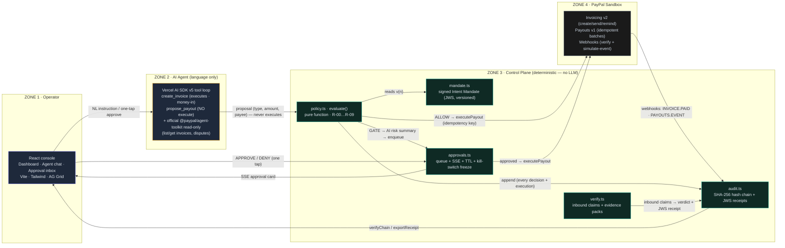

**The trust boundary (●) sits between zones 3 and 4**: PayPal calls for money-out are reachable *only* from the control plane, and only after a policy pass (plus a human approval when gated). The agent holds no PayPal credentials for money movement.

---

## 2. Policy engine decision flow — `policy.ts evaluate()`

**What it tells you:** the exact order the engine checks a proposal, and why order matters. Hard BLOCKs (payee, currency, daily cap) are evaluated **first** — so no approval, prompt or reasoning can reach them. Standing envelopes are matched before thresholds so a pre-authorized run never trips its own limit. Read it top-to-bottom as: *can I refuse instantly? → is this pre-signed? → does a human need to see it? → otherwise, run it.*

Pure function. Input: `ProposedAction` + signed `IntentMandate` + engine-owned counters (dailySpent, recent payouts). Output: `ALLOW | GATE | BLOCK` with reason codes.

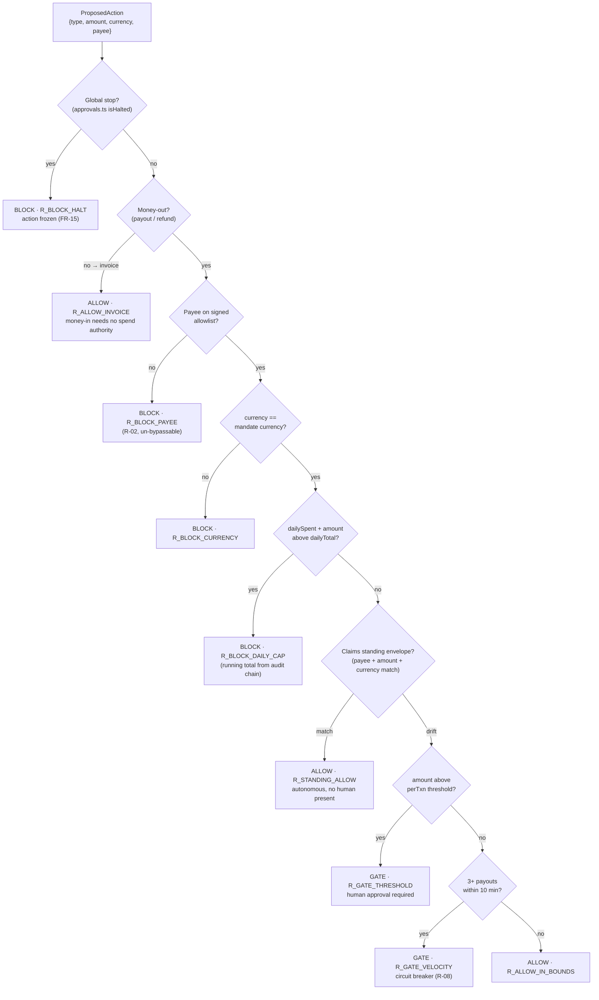

Gate ≠ block: a GATE queues an approval card (AI-written risk summary attached) with a 10-minute TTL. A BLOCK has **no approval path** — only a signed mandate change (new version) can alter the rules.

---

## 3. Sequence — the gated payout (UC-03, the money shot)

**What it tells you:** the full life of the $500 payout, from a plain-English sentence to a real PayPal batch. Follow the audit chain on the right — a record is committed at every decision point (proposal verdict, human approval, execution, settlement), so the finished payout has a complete, independently verifiable paper trail. The DENY path skips everything after the approval card.

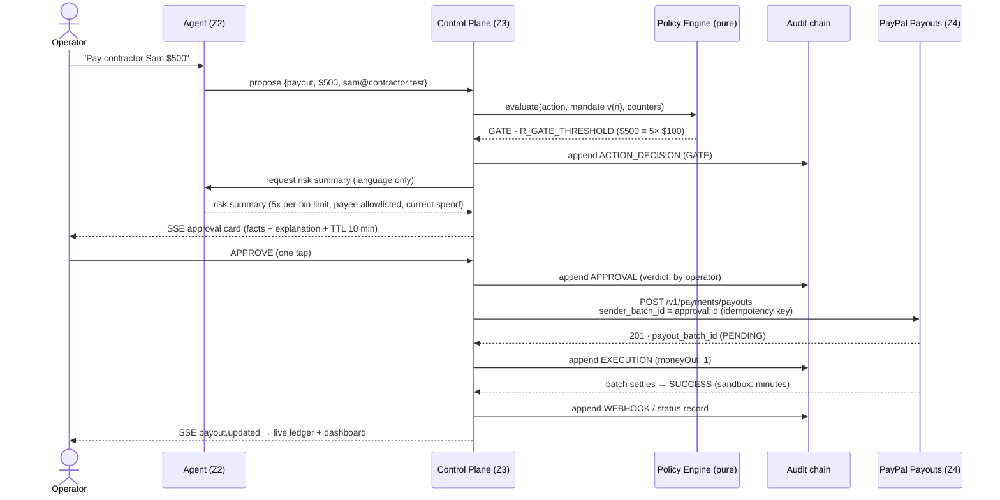

A **DENY** at the approval step skips everything after the card: action → DENIED, audited, never executed. Re-submission is a no-op — the idempotency key `approval:<id>` is already stored.

---

## 4. Sequence — standing payout: autonomous when in-bounds, gates on drift (UC-08)

**What it tells you:** how autonomy without abdication works. The human signs the envelope *once* ($300/week → vita@va.test); from then on the engine's idempotency guard + envelope check run the payout unattended. The moment any parameter drifts ($150 instead of $300), the same mandate that granted autonomy withdraws it — no re-prompting, no new rules.

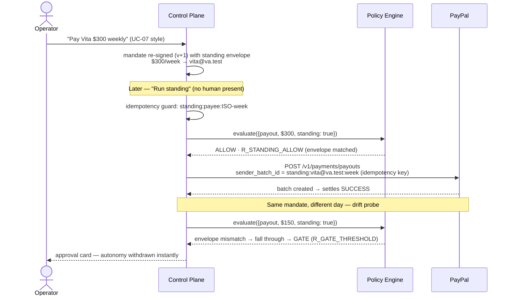

The signed envelope moves the human to **authorization time, not execution time** — the answer to "you can't put a human in the hot path."

---

## 5. Flow — inbound claim verification (the Netflix check, UC-10/11)

**What it tells you:** how an inbound "Netflix" claim is judged without trusting its branding. Four independent checks run in order — directory, sender domain (exact vs lookalike), amount envelope, payment history — and the worst flag wins. A lookalike domain plus an inflated amount is an IMPOSTOR; a genuine price hike from the real domain is only SUSPICIOUS. The verdict is signed and committed like any other record.

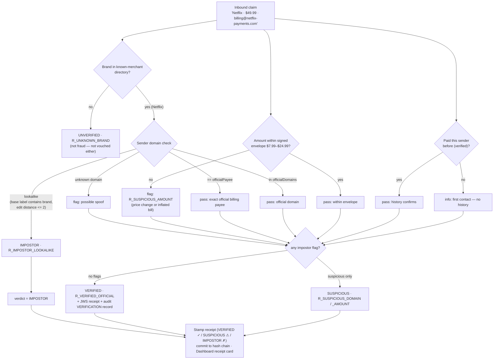

Same checks, both directions: UC-10 catches the impostor; UC-11 shows the genuine bill verifying silently and an official-sender **price hike** flagged rather than silently paid.

---

## 6. Sequence — dispute evidence pack (UC-12)

**What it tells you:** what happens when a payee disputes a payment. Instead of an argument, Mandate compiles a single signed artifact — the human approval record, the PayPal batch id with its **live** status (polled, since sandbox batches settle asynchronously), and the audit-chain position. The packHash + HMAC make the pack independently verifiable.

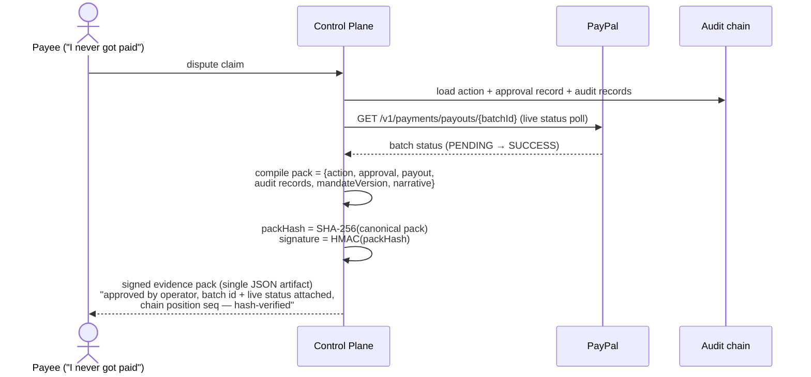

The dispute is answered with **PayPal's own ledger + the immutable chain**, not an argument.

---

## 7. Action lifecycle state machine

**What it tells you:** every state an action can be in, and the only transitions between them. Two details to notice: resubmission of an EXECUTED action is a self-loop (idempotency — it can never double-pay), and HALTED is reachable from anywhere while the kill switch is on. DENIED and EXPIRED actions are terminal — they can never execute later.

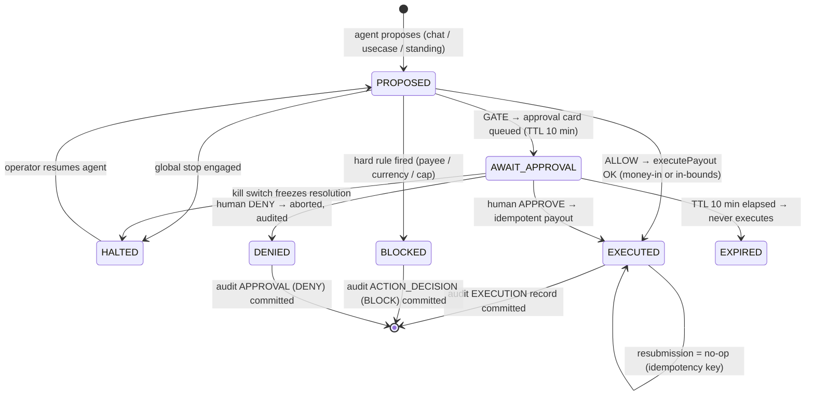

---

## 8. Invoice lifecycle (money-in, UC-01/02)

**What it tells you:** the money-in loop the agent runs unattended — create, send, sweep overdue, chase with escalating AI reminders (PayPal allows 2 reminders/invoice/day), plus PayPal's own native auto-reminders configured once at bootstrap. The CREATED → resend path is the honest handling of the sandbox's send restriction.

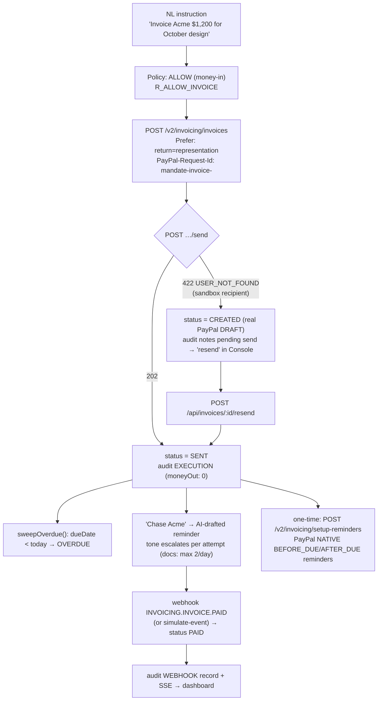

---

## 9. Audit hash chain — how tampering is detectable

**What it tells you:** why the audit log is tamper-*evident*, not just stored. Each record hashes the previous record's hash into its own, so changing any historical record breaks every hash after it — `verifyChain()` recomputes all links and pins the exact break point. Money-out totals are computed from this chain, never from the model's memory.

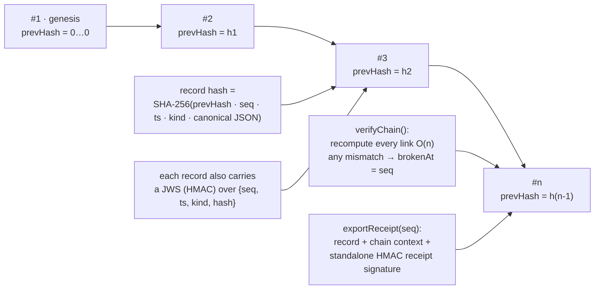

Kinds appended: `ACTION_DECISION` · `EXECUTION` · `APPROVAL` · `MANDATE_SIGNED` · `WEBHOOK` · `VERIFICATION` · `SYSTEM`. Money-out totals ("spent today") are computed **from this chain** — never from the model.

---

## 10. Data model (SQLite — `node:sqlite`, zero native deps)

**What it tells you:** the entire persistent state of the product — nine tables, no more. Actions are the spine; approvals, payouts and invoices hang off them; the audit chain is append-only and rebuildable. Note there is no session or credential table: the kill switch and policy live in the signed mandate, not in server memory.

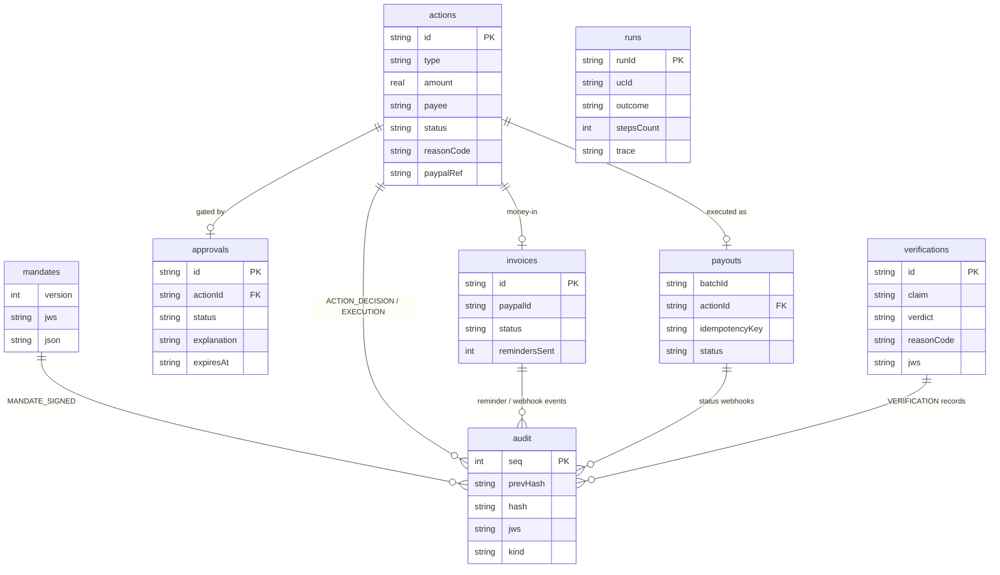

`meta` (key/value) holds the kill-switch flag and one-time bootstrap markers. Every table is rebuildable from the audit chain except credential-derived artifacts.

---

## 11. Deployment architecture

**What it tells you:** how this ships. One build (relative assets) runs at localhost, on Render (API + console same-origin — the full product), on a Vultr VM with Caddy auto-HTTPS (the live deployment: `https://139-84-172-28.sslip.io`), and on GitHub Pages (static console pointed at a hosted API). Cross-origin access is allow-listed and admin-token-guarded; nothing is open-wide. The webhook listener needs no dashboard step: with `PUBLIC_BASE_URL` set, the server self-registers it at boot and reconciles anything a delivery missed.

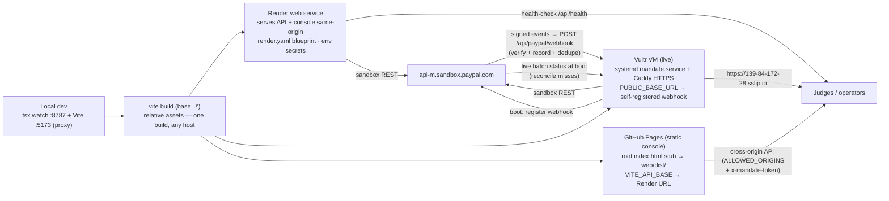

Security posture: no open CORS (allow-listed origins only), `MANDATE_ADMIN_TOKEN` guards every mutating route, `.env` gitignored, secrets scanned before every push.

---

## 12. Workflow — how a use-case run becomes dashboard evidence

**What it tells you:** why the numbers in RESULTS.md are trustworthy. A use-case run is not a script that prints a verdict — it drives the real pipeline, collects the trace, commits it to the runs table, and the same artifacts land on the Dashboard, in the Usecases UI and in `evidence/` for the repo. One source of truth, three views.

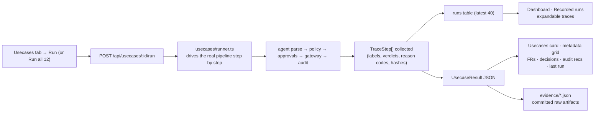

The Usecases tab and the Dashboard read the same recorded truth — the traces are the engine's real decisions, never canned copy.
